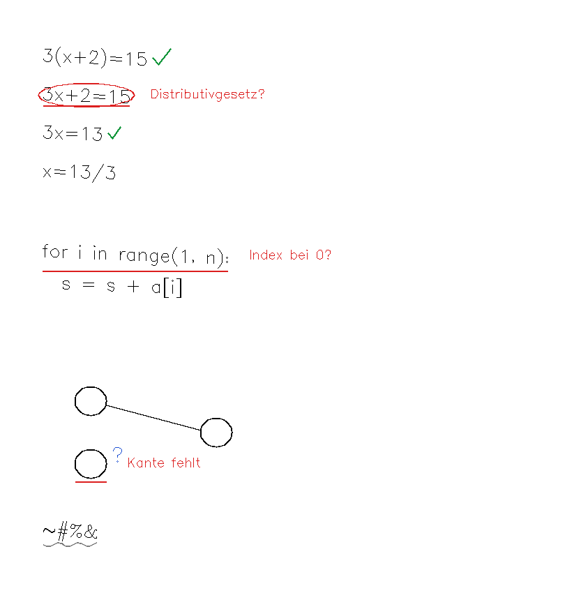

# inkpartner

Ein eigener Versuch, wie ein Agent dich auf dem reMarkable **in jedem Fach** begleitet: Er liest mit
und antwortet mit Zeichen auf derselben Seite, wie ein Lehrer mit Rotstift. Er rechnet dir nichts vor.

Neben den bestehenden Projekten (`algebra-agent`, `pur`, `underline`, `rm-drill`) setzt dieses Repo
an einer anderen Stelle an: **nicht beim Transport, sondern bei der Sprache, in der der Agent auf
Papier antwortet**, und bei den Regeln, die für jedes Fach gleich gelten.

## Die Idee in einem Satz

Eine Seite wird zu einer Liste von **Elementen** (Zeile, Formel, Code-Zeile, Knoten, Kante, Kasten …).
Der Agent schlägt **Aktionen** auf diesen Elementen vor. **Regeln** entscheiden, was davon
tatsächlich als Tinte erscheint. Das Fach ändert nur das Urteil, nicht den Ablauf.

```
.rm-Seite ─▶ lesen (ganze Seite → Elemente mit Box) ─▶ prüfen (sympy, wo es geht)
          ─▶ urteilen (Profil des Fachs) ─▶ Regeln ─▶ Zeichen als Striche ─▶ zustellen ─▶ zurücklesen
```

## Die Wege des Agenten (marks.py)

| Zeichen | Bedeutung | Farbe |
|---|---|---|
| **Haken** | richtig | grün |
| **Unterstreichen** | richtig (grün) oder falsch (rot) | grün / rot |
| **Kreis** | hier ist der Fehler | rot |
| **Wellenlinie** | kann ich nicht lesen | grau |
| **Fragezeichen** | schau hier noch mal hin | blau |
| **Notiz** | kurzer handschriftlicher Text: Korrektur oder Denkanstoß | rot / blau |
| **Pfeil** | verbindet eine entfernte Notiz mit ihrem Element | Farbe der Notiz |

Die **Farbe wählt nie das Modell**, sondern das Urteil: richtig = grün, falsch = rot,
Hinweis = blau, unlesbar = grau. Damit gilt die Farbsemantik aus Notion immer.



## Die Regeln (plan.py, delivery.py, speech.py)

- Eine **unsichere Lesung wird nie grün**. Eine unleserliche Stelle bekommt nur eine Wellenlinie.
- **Wo sympy entscheiden kann, entscheidet sympy.** Widerspricht das Modell, wird seine Aktion
  verworfen. Schritte, die sympy als richtig belegt, bekommen ihren Haken, auch wenn das Modell ihn
  vergisst. Folgefehler bleiben richtig: Jeder Schritt wird gegen den direkt davor geprüft.
- **Klein und inkrementell**: höchstens 3–4 Zeichen pro Runde, Fehler zuerst.
- **Nichts doppelt**: Was schon auf der Seite steht, wird nicht noch einmal geschrieben.
- **Platz findet sich immer**: erst freie Stelle neben dem Element, dann irgendwo frei mit Pfeil,
  zur Not überlappend. Nie „kein Platz, ich schreibe nichts".
- **Zugestellt heißt: auf der Seite gesehen.** Nach jedem Schreiben wird zurückgelesen. Es gibt drei
  Ergebnisse: bestätigt, fehlt, unklar. Bei „unklar" wird erst nachgeschaut, nicht doppelt geschrieben.
- **Fehler behebt der Agent selbst**: Er versucht es mit wachsenden Pausen erneut und lässt einen
  kaputten Weg ruhen (Circuit Breaker). Dich fragt er nicht.
- **Veraltetes wird verworfen**: Hast du die Stelle inzwischen geändert, kommt der Hinweis nicht mehr.
- **Stumm bleibt stumm**: Sprache nur, wenn du sie für die Sitzung erlaubst, und nur natürliche
  Sprache, also keine Formeln, kein Code und keine Pfade.

Die vollständige Liste mit Herkunft steht in [docs/INTERAKTIONSREGELN.md](docs/INTERAKTIONSREGELN.md).

## Harte Grenzen beim Schreiben (guards.py)

Diese Prüfungen stecken in den Schreibbefehlen selbst. Kein Aufrufer kommt an ihnen vorbei.

| Regel | Was sie verhindert | Woher |
|---|---|---|
| R-RESTART | Neustart (meldet dich ab) nur ausdrücklich erlaubt, nach 30 min ohne Änderung auf irgendeiner Seite und ohne Stiftaktivität, höchstens 1× pro Stunde | 23.10.: nach 4 min Lesen rausgeworfen |
| R-PEN-NEAR | keine Stiftsignale, solange dein Stift in Reichweite ist | 23.10.: Striche zu einer Linie verschmolzen |
| R-OPEN | Stiftsignale nur in die Seite, die gerade offen ist (aus dem Log der Notiz-App) | sonst Tipper in Menüs oder auf fremden Seiten |
| R-VIEWPORT | Stiftsignale nur bei bekannter, ungezoomter Ansicht (`--trust-viewport`, bis Zoom erkannt wird) | 23.10.: Notiz als großes Gebilde über deiner Rechnung |
| R-FOREIGN | unerwartete Striche in deiner Ebene nach dem Schreiben → **Not-Aus** (Datei `~/.cache/inkpartner/STOP`) | dasselbe |
| R-PREFIX | eine Seitendatei darf nur wachsen, deine Bytes bleiben unverändert | Produktvertrag |
| R-RATE | höchstens 4 Stift-Auslieferungen pro Minute | gegen Schleifen |

Nach einem Not-Aus schreibt nichts mehr, bis du die STOP-Datei nach einem Blick aufs Tablet löschst.

## Fächer (profiles.py)

`math` (mit sympy) · `code` (Code auf Papier) · `diagram` (Graphen, Automaten, neuronale Netze,
UML/ER) · `pm` (Projektmanagement) · `prose` (Vorlesungsnotizen). Ein neues Fach ist ein neues
Profil, keine neue Pipeline.

## Benutzen

```bash
pip install -r requirements.txt
PYTHONPATH=src python3 -m inkpartner demo --preview demo.png          # ohne Tablet, ohne Modell
PYTHONPATH=src python3 -m inkpartner review seite.rm --preview out.png  # liest + urteilt mit Claude
PYTHONPATH=src python3 -m inkpartner review seite.rm -o seite-mit-agent.rm
PYTHONPATH=src python3 -m unittest discover -s tests
```

`review` braucht Zugang zur Claude-API (`ANTHROPIC_API_KEY` oder `ant auth login`). Ohne
`--subject` erkennt das Modell das Fach selbst.

## Was belegt ist und was nicht

| | Stand |
|---|---|
| Zeichen, Platzierung, Regeln, Rückprüfung, Zustell-Logik | 25 Tests, simuliert |
| `.rm` lesen und Agentenebene anhängen, Originalbytes bleiben erhalten | Test mit Fixture, **nicht am Gerät** |
| Lesen und Urteilen mit Claude | Anfrageform mit Fake-Client getestet, **kein echter Modelllauf** |
| Zustellen ohne Unterbrechung | **nicht in diesem Repo.** Der unterbrechungsfreie Weg ist der virtuelle Stift aus `algebra-agent` (`live.py`, `inject.py`). `delivery.Outbox` erwartet nur ein Objekt mit `deliver(strokes)`. |

**Offener Zielkonflikt, deine Entscheidung:** Der virtuelle Stift schreibt ohne Neustart, aber mit der
gerade gewählten Stiftfarbe in deiner Ebene. Der Dateiweg kann Farbe und eine eigene Ebene, startet
aber die Oberfläche neu. Beides zugleich kann heute kein Weg. Die Rückprüfung hier ignoriert deshalb
Farbe und Ebene absichtlich: Sie erkennt die Tinte auf beiden Wegen.

Vergleich mit den bisherigen Varianten: [docs/VERGLEICH.md](docs/VERGLEICH.md).
Messergebnisse der Simulation als Seite: [docs/messstand/](docs/messstand/README.md).
Wie das Projekt gearbeitet hat: [docs/ARBEITSWEISE.md](docs/ARBEITSWEISE.md); allgemein für andere Projekte: [docs/METHODE.md](docs/METHODE.md) (als Skill: `skills/experiment-zu-projekt/`).
