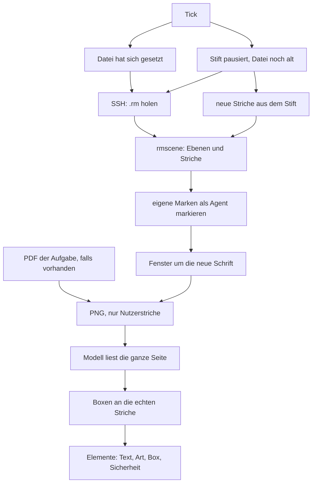

# Lesen: von der Seite zu den Elementen

Der Watcher-Weg. Das Urteilen beginnt erst nach der Elementliste. Andere Leser (`lines`, `ocr`, `shot`, `agree`) gibt es zum Vergleich; der Watcher ruft `agent.read` auf.

`tick` liest die Seite, die sich gesetzt hat, oder früher aus dem Stift, wenn die App noch nicht gespeichert hat. `read_strokes` macht aus der `.rm`-Datei Striche in Seitenpixeln. Eigene Marken zählen als Agent und kommen nicht ins Bild. `focus` lässt nur das Fenster um die neue Schrift. Das Modell bekommt ein PNG und liefert die Elemente; `snap` zieht die Boxen auf die echten Striche.
